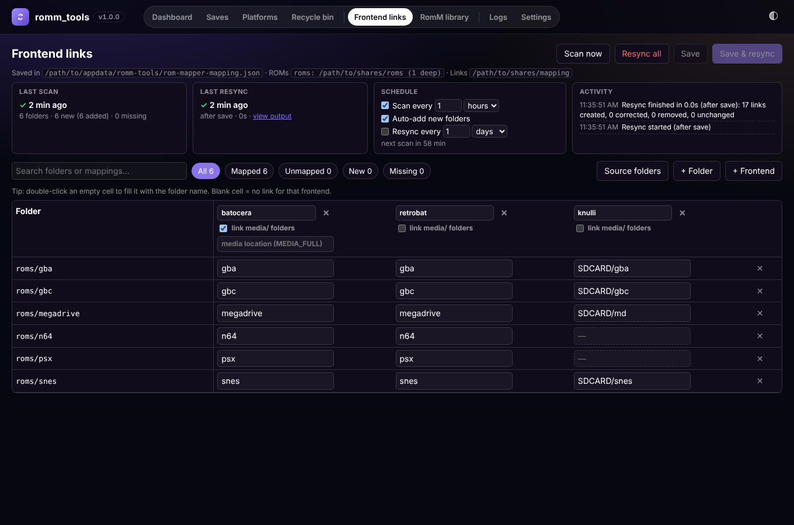
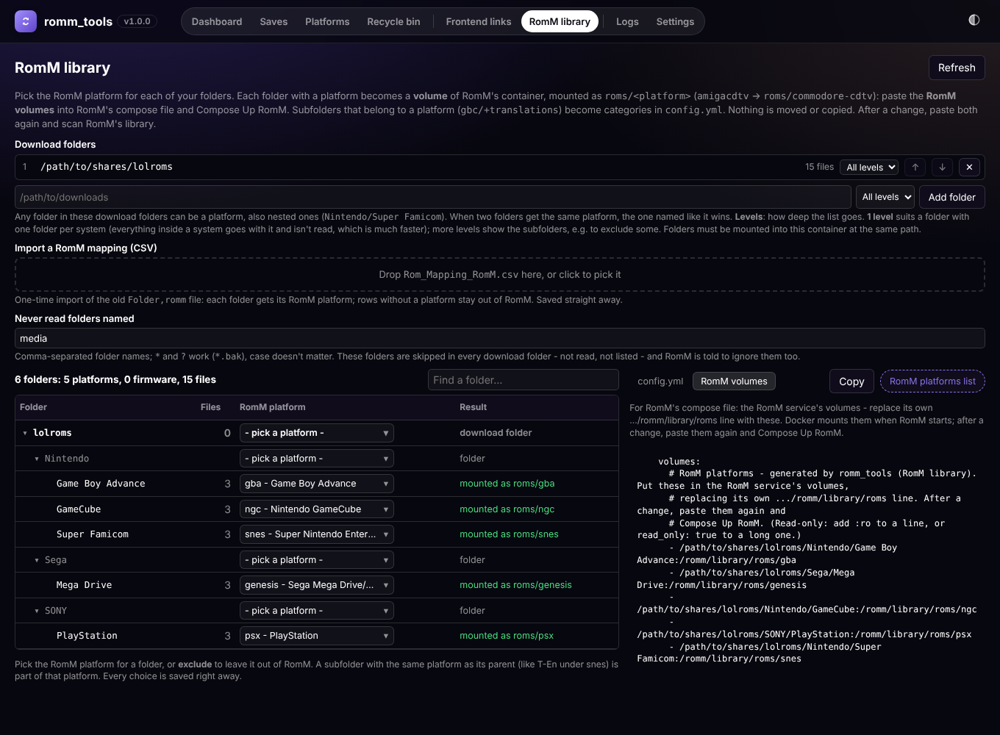
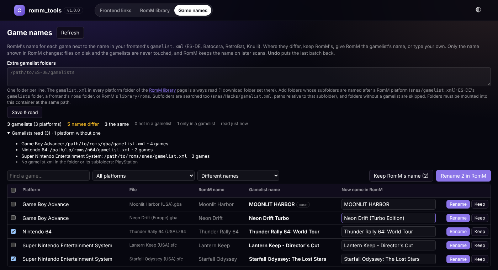

# ROM folders reference

The **ROM folders** part of [romm_tools](../README.md) - the *Frontend links* and *RomM library*
pages. It was [ROM Mapper](https://github.com/sireteanu/rom-mapper) (sireteanu/rom-mapper) and
moved here with its history; it works the same, in the same web page as save sync.

ROM folders builds folder layouts for emulation frontends (Batocera/RGS, RetroBat, Knulli, ...)
out of **links** into your ROM folders, and gives [RomM](https://github.com/rommapp/romm) its
platform folders as volume mounts of your folders. Nothing is copied or moved: each frontend gets
its own folder of links, named the way that frontend expects, pointing at the one copy of your
files. It doesn't need a RomM connection.

**Linux and Docker only** - it relies on Linux paths and symlinks. Its pages are at
`http://SERVER:8080/roms/` (`#links`, `#romm`), reached from the menu as **Frontend links** and
**RomM library**; the open page is kept in the address and remembered by the browser.
Install and the settings shared with save sync are in the [README](../README.md); step by step
instructions are in the [user guide](user-guide.md).



---

## Contents

1. [Features](#features)
2. [The one folder mounted at the same path](#the-one-folder-mounted-at-the-same-path)
3. [How it works](#how-it-works)
4. [RomM](#romm)
5. [Game names](#game-names)
6. [Settings and files](#settings-and-files)
7. [Upgrading from older versions](#upgrading-from-older-versions)

---

## Features

| Area | What it does |
|---|---|
| Mapping grid | One row per folder found in your source folders, one column per frontend. Type the name a frontend should see; blank = no link. Double-click an empty cell to use the folder's own name. |
| Source folders | Any number of folders, each read to a chosen depth (1 = folders directly inside it, 2 = also the folders inside those, up to 6). Rows show the source folder's name in front: `<source>/<path>`. |
| Frontends | Add or remove columns. Each frontend can also link every system's `media/` folder into a sub-folder (default `MEDIA_FULL`). |
| Links | **Resync all** makes the mapping folder match the mapping: missing links are made, wrong ones corrected, unused ones removed - nothing else is touched, and frontends never see an empty folder. |
| Status | Rows are marked *New* (on disk, not mapped yet), *Unmapped*, *Missing* (mapped, gone from disk). Filter by status, search, remove missing rows. Duplicate names for one frontend are highlighted (the first row gets the link). |
| Schedule | Scan and resync each on their own interval, in minutes, hours or days (scans can add new folders automatically). |
| RomM | Pick the RomM platform for any of your folders; romm_tools generates the volume lines for RomM's compose file (each folder mounted as `roms/<platform>`) and a `config.yml` with category levels for platforms with subfolders. |
| Game names | RomM's names next to the names in your frontends' `gamelist.xml`; rename games in RomM to the gamelist's name or your own, with Undo. |
| Storage | Everything is stored by the app in its config folder (JSON); no files to edit by hand. |

---

## The one folder mounted at the same path

ROM folders needs **one** folder mounted at the **same path** inside the container as on the host,
containing everything it uses: your source folders, the mapping folder and RomM's download folders.
Pick a folder high enough to cover them all (on Unraid, `/mnt/user` covers every share). Folders are
then chosen in the web page - adding one never needs another mapping.

**Why the same path?** Links are absolute. A folder mounted at `/roms` inside the container would
produce links to `/roms/...`, which don't exist on the host.

**Permissions:** the container needs write access to the mapping folder and (for old platform links)
the folder that holds the download folders. The container runs as root for save sync; with `PUID` /
`PGID` set (Unraid: 99 / 100) every link and folder it makes is handed to that user, so the shares
stay editable over SMB. Running the container as that user instead (`user: "99:100"`, ROM folders'
old way) works too.

---

## How it works

### Rows and keys

Every row is a folder written as `<source name>/<path inside it>`, e.g. `roms/snes` or
`downloads/Nintendo/Super Famicom`. The source name is the source folder's own name (made unique
with `-2`, `-3` if two have the same name) and stays the same when you reorder the list, so saved
rows keep pointing at the right place. A row without a known source name in front (from older
versions) belongs to the **first** source folder.

### Scanning

**Scan now** (and the scheduled scan) reads every source folder down to its depth. Folders starting
with `.`, folders named `media`, and links are skipped. Folders that aren't in the mapping yet are
*New*; with *Auto-add new folders* they're added to the mapping (unmapped). Mapped folders that no
longer exist are *Missing* - their links wait until they come back. The page re-reads the folders
when it refreshes (every 30 s, reusing a listing up to 10 s old). A page in a hidden browser tab
doesn't refresh, so a forgotten tab doesn't keep disks awake; it refreshes as soon as you come back.

### Links (Resync)

For every row and frontend with a name:

```
<mapping folder>/<frontend>/<name>  ->  <source folder>/<path>
```

`<name>` may contain `/` (e.g. `SDCARD/snes`). With *link media/ folders* on for a frontend, and a
`media` folder inside the source folder:

```
<mapping folder>/<frontend>/<media location>/<name without its first part>/media  ->  <source folder>/<path>/media
```

A resync compares what should exist with what does: it creates missing links, corrects links that
point elsewhere, removes links no row wants any more (and folders left empty), and leaves
everything else alone. Only links are ever removed - a real file or folder in the mapping folder is
reported and kept. When two rows give one frontend the same name, the first row (grid order) gets
the link and the output says which was skipped. The mapping folder may not be `/`, a top-level
share folder, inside a source folder, or contain one.

---

## RomM

RomM wants one folder per platform, named by its *slug* (`snes`, `psx`, ...), directly inside its
roms folder. romm_tools decides which of your folders is which platform and gives you the
**volume lines for RomM's compose file**: each of those folders is mounted into RomM's container
under the platform's name, by Docker, every time RomM starts:

```yaml
    volumes:                      # the RomM service
      - /path/to/roms/amigacdtv:/romm/library/roms/commodore-cdtv
      - /path/to/roms/gbc:/romm/library/roms/gbc
      - /path/to/lolroms/Nintendo/Super Famicom:/romm/library/roms/snes
```

RomM sees plain folders with the right names - no renames, no platform excludes, nothing moved, no
script and no extra rights for romm_tools. These lines replace RomM's own `.../romm/library/roms`
line. After a change, paste them again and **Compose Up** RomM (a folder with a `:` in its name
gets compose's long syntax; add `:ro` / `read_only: true` for read-only).

- **Download folders**: any number; any folder in them can be a platform, nested ones too. Read
  in the background with a progress bar; counts are reused for 30 s, after that only folders whose
  date changed are listed again, with a full read every hour and on **Refresh**.
- **Levels**: how deep the list goes. Use at least **2 levels** where systems have subfolders
  (`gbc/+translations`): at 1 level subfolders aren't read and can't become categories (a warning
  says so). **Never read folders named** (default `media`) skips folders everywhere and tells RomM to
  ignore them too. Excluded folders aren't read inside.
- **Platforms**: folders named like a RomM platform get it automatically, lolroms' tree has built-in
  rules; pick the rest in the searchable picker, or **exclude**. A name RomM doesn't know can be used
  too (*Use "…" as a custom platform*: lowercase, spaces become `-`); RomM adds it without metadata,
  and custom platforms in use are offered again in the picker. A platform counts when it or anything
  below it has files. Two folders for one platform: the one named like it wins, else the shallower,
  else the first by name (a warning names both).
- **Categories**: a platform whose subfolders belong to it (*category of gbc* in the list) gets
  `roms/{platform}/{game}` and `roms/{platform}/{category}/{game}`, keyed by the platform. Every such
  subfolder is then a category - exclude (or never-read) the ones that aren't, like `images` or
  `manuals`. A subfolder that is a platform of its own (lolroms' `Satellaview`) gets its own mount.
- **RomM volumes** tab: the volume lines above, for the RomM service in its compose file.
- **Import a RomM mapping (CSV)**: a one-time import of the old `Rom_Mapping_RomM.csv`
  (`Folder,romm`): drop it on the tab and every folder gets its platform. Folders are looked up in
  the download folders; an empty platform means "not in RomM" (excluded if the folder's name would
  make it a platform anyway). A summary lists missing folders, custom platforms and skipped values.
- **config.yml**: merge into RomM's `config.yml` and restart RomM - `filesystem.structure` (default,
  firmware, the platforms with categories), `exclude.roms.multi_file.names` (subfolders that aren't
  games: never-read names, firmware, raw dumps, your excludes, platforms of their own) and
  `system.versions` for arcade boards RomM has no platform for.

Older versions made platform links next to the download folders: **Remove old platform links** (top
right) appears while any are left and removes only those.

RomM facts this relies on are listed in `src/mapper/romm.py`'s docstring - re-check them when RomM changes.



The platform picker lists RomM's platforms from the built-in list (`src/mapper/romm_slugs.py`) plus
any newer ones in the platform catalog save sync downloads from RomM's GitHub
(`/data/romm_platforms.json`, refreshed weekly).

---

## Game names



The **Game names** page (`/roms/#names`) lists every game whose name in RomM differs from its
`<name>` in a frontend's `gamelist.xml` (ES-DE, Batocera, RetroBat, Knulli). For each one you can
give RomM the gamelist's name (**Rename**), type another name first, or **Keep** RomM's name. Tick
several (or the box in the header for every game shown) to do them at once. **Undo last rename** puts
back the names of the last batch (the last 20 batches are kept).

Only the name RomM shows changes: romm_tools sends just `name` to `PUT /api/roms/{id}`. Files on disk
and the gamelists are never touched. RomM derives the sort name again and keeps a name it was given
when it scans the library later (until you *Unmatch* the game in RomM, which resets the name to the
file name). Writing needs a RomM user or API token with **write access to ROMs** (`roms.write`) - the
token from the save sync setup only reads ROMs.

**Where the gamelists are read**

- The `gamelist.xml` in every platform folder of the **RomM library** page - the folder mounted as
  `roms/<platform>`, which is also the file RomM's own *gamelist* metadata source reads.
- **Extra gamelist folders** (set on the page): folders whose subfolders are named after a RomM
  platform (its folder name or slug): ES-DE's `gamelists` folder, a frontend's `roms` folder, or
  RomM's `library/roms`. They must be mounted into the container at the same path.

Not every folder needs a gamelist; platforms without one are listed under *Gamelists read*.
**Subfolders** are searched too, up to 4 levels: a gamelist in `snes/Hacks/` lists its games relative
to `Hacks/`, so they match RomM's games in that category. Media folders (`media`, `images`, `videos`,
`manuals`, ...), the *Never read folders named* of the RomM library page and folders that are another
platform aren't searched. When two gamelists list the same game, the one nearer the platform folder wins.

**Matching** works like RomM's: the game's path inside the platform folder (`Hacks/Game.sfc`) first,
else the file name alone when only one gamelist entry has it. The counts show how many names are the
same, how many RomM games no gamelist lists, and how many gamelist entries have no RomM game.
*Keep* hides a game until its gamelist name changes; *Kept as in RomM* in the **Show** list brings them
back, and *Only upper/lower case differs* finds names like `MOONLIT HARBOR`.

Reading a big library takes a moment (it runs in the background with a progress bar). It happens when
the page opens for the first time and on **Refresh** - nothing runs on a schedule.

---

## Settings and files

All in the app data folder (`/data` in Docker; `CONFIG_DIR` points it elsewhere, e.g. `/config` with a rom-mapper config folder):

| File | What |
|---|---|
| `rom-mapper-mapping.json` | The mapping: frontends (name, media toggle, media location) and rows (folder, one name per frontend) |
| `rom-mapper-mapping.json.bak` | The previous version, written on every save |
| `rom-mapper-state.json` | Source folders, schedule settings (`scan_every` / `scan_unit`, `sync_every` / `sync_unit`; units `minutes`, `hours`, `days`), last scan and last resync |
| `game-names.json` | Game names: extra gamelist folders (`folders`), games you keep RomM's name for (`ignored`: RomM id -> the gamelist name at the time), the last 20 batches of renames for Undo (`history`) |
| `romm-mapper.json` | RomM: download folders (`sources`), levels per folder (`depths`, only those not set to all), folder names never read (`skip_names`; missing = `["media"]`), your choices (`map`, by `<download folder>/<path>`: a slug, `exclude`, ...; 1.0.9's `cat:<slug>` reads as the slug). Settings of the platform-links versions (`links_dir`, `keep_links`, `romm_folder`, `layout`, `variants`, `mode`) are ignored |

Files are written to a temporary file first and then swapped in, so a crash never leaves half a
file. Environment variables:

| Variable | Meaning |
|---|---|
| `SRC_BASE` | First source folder(s) for the grid, `;`-separated, until you set the list in the page (compose: `ROMS_PATH`) |
| `DEST_PATH` | The mapping folder: one sub-folder of links per frontend (compose: `MAPPING_PATH`). Empty = no links until it's set |
| `ROMM_SOURCE` | RomM download folders, `;`-separated, until set in the page |
| `CONFIG_DIR` | Where the files above live (default: `DATA_DIR`, i.e. `/data`) |
| `MAPPING_FILE` / `STATE_FILE` | Override the two file paths |
| `ROM_FOLDERS` | `false` turns this part off |
| `PUID` / `PGID` | Owner of new links and folders when the container runs as root |
| `TZ` | Time zone for the schedule |

---

## Upgrading from older versions

Older files keep working; the tests in `tests/mapper/test_upgrades.py` check every case. The version
numbers below are ROM Mapper's ([its changelog](history/rom-mapper-CHANGELOG.md)):

- **`Rom_Mapping.csv`** (before 1.0.0) is no longer read since 1.0.3. Versions 1.0.0 to 1.0.2
  imported it into `rom-mapper-mapping.json` at their first start; that mapping keeps working (its
  rows, plain folder names, belong to the first source folder). The CSV file is left where it is.
- **Rows without a source name** keep pointing at the first source folder, even after the list is
  reordered (they get the name written in front when the order changes).
- **Schedule in minutes and hours** (before 1.0.3: `scan_interval_minutes`, `sync_interval_hours`):
  converted to a number and a unit, in the largest unit that fits (60 minutes -> 1 hour, 24 hours ->
  1 day, 2.5 hours -> 150 minutes). Same intervals as before.
- **`romm-mapper.json` with one folder** (`source`) or from Rom Sync (no folder list, choices
  without a folder name): converted to the folder list; choices get the first folder's name in
  front; a relative links folder is dropped.
- **Platform-links settings** (before 1.0.9): ignored; your choices stay. Links an older version
  made can be removed with **Remove old platform links**.
- **`rom-mapper.sh`** (the bash script before 1.0.0) is replaced by the built-in resync, which makes
  the same links.
- **ROM Mapper's container** (sireteanu/rom-mapper, up to 1.0.14): copy `rom-mapper-mapping.json`,
  `rom-mapper-state.json` and `romm-mapper.json` from its config folder into romm_tools' app data
  folder (or mount the old folder and set `CONFIG_DIR` to it). Mount the same emulation folder at the
  same path, and the links, schedule and RomM choices carry on unchanged. The page moved from port
  8085 to `http://SERVER:8080/roms/`; the one-off resync is now
  `docker exec romm-tools python romm_tools.py --resync`.

