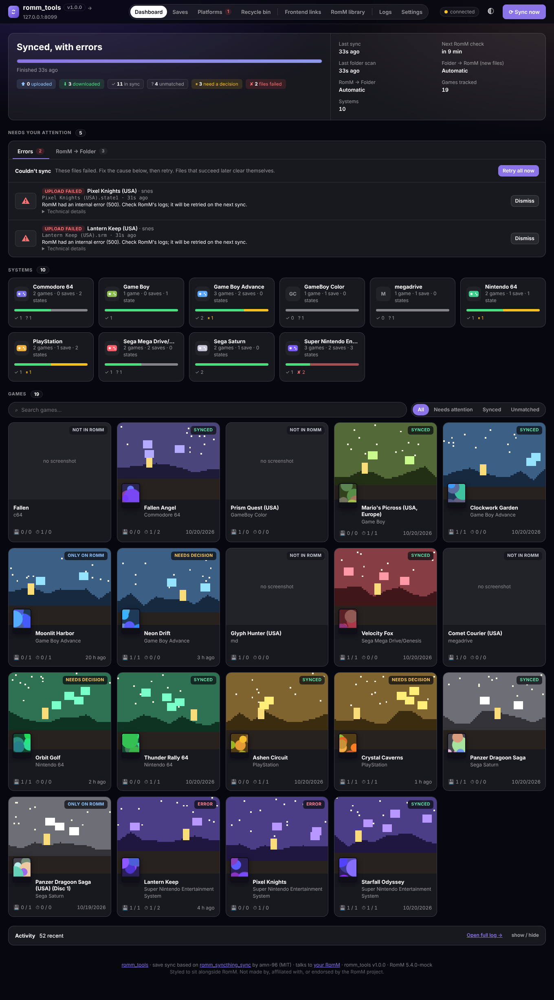
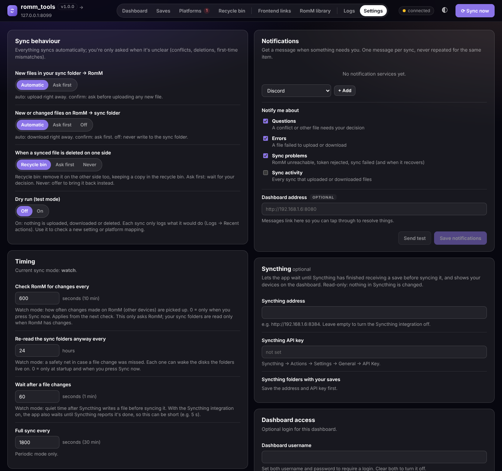
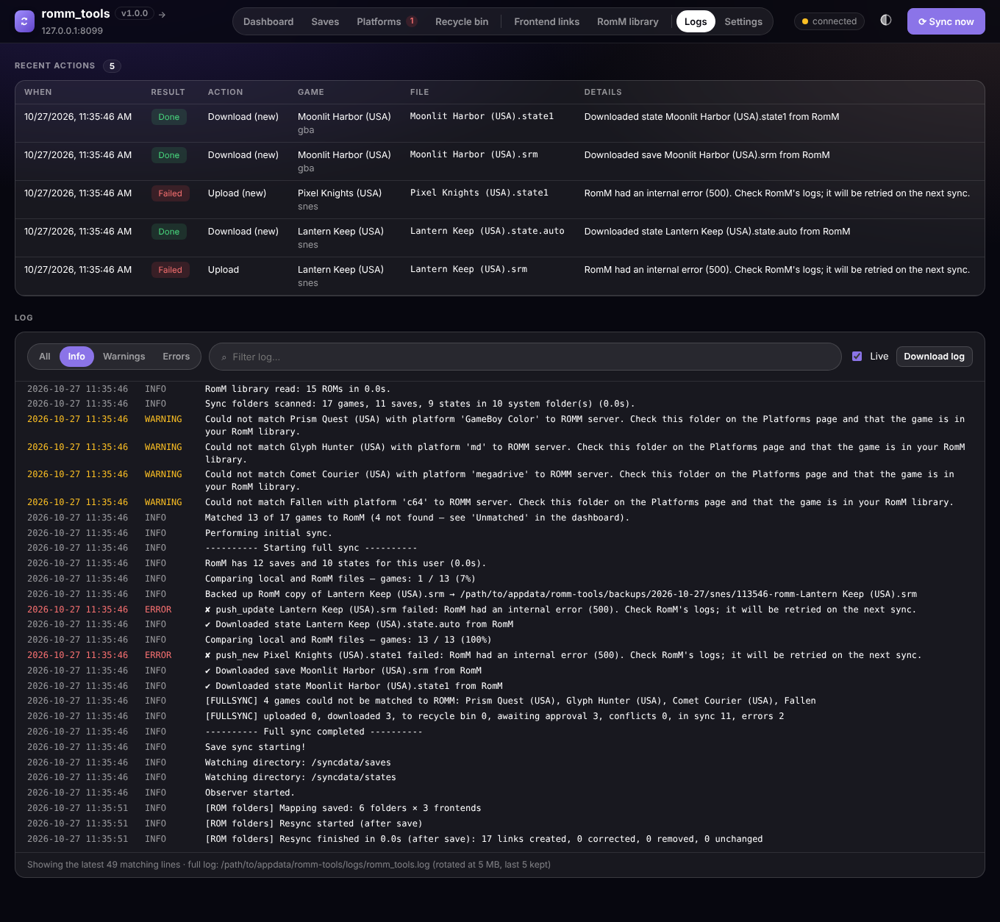
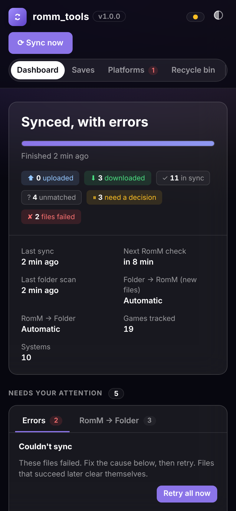
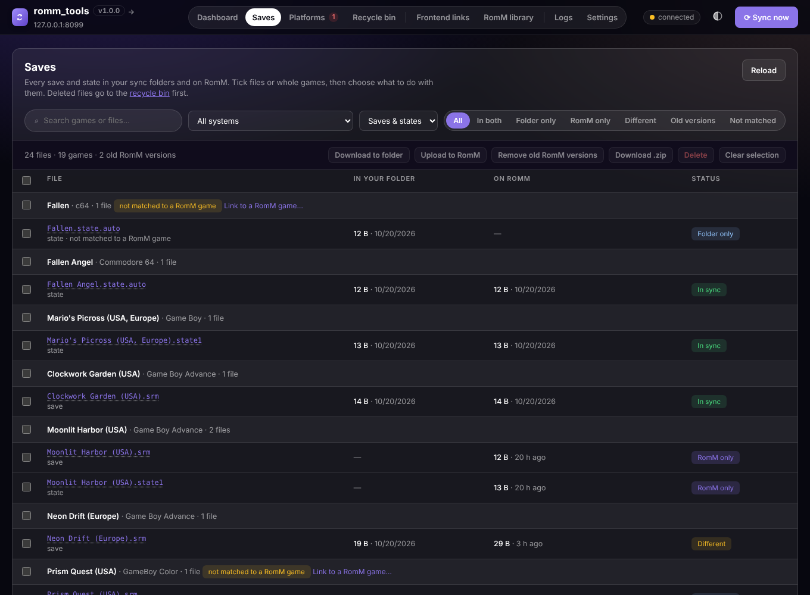
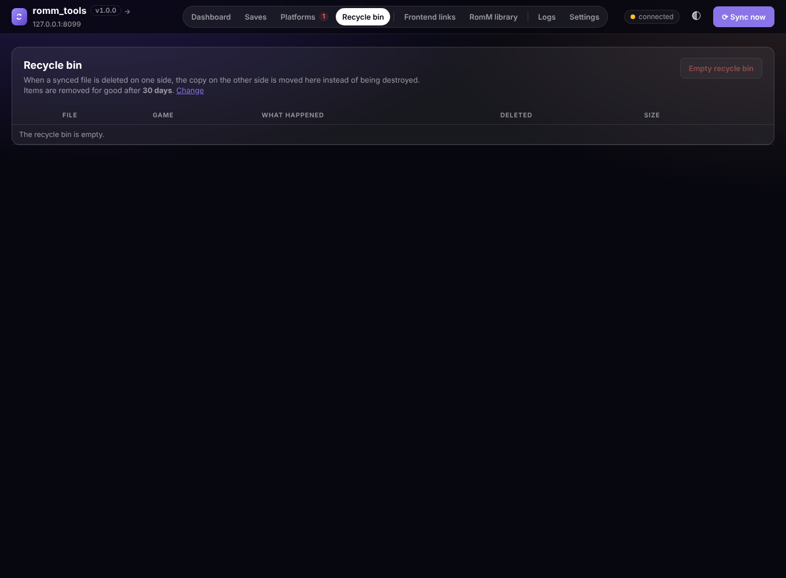
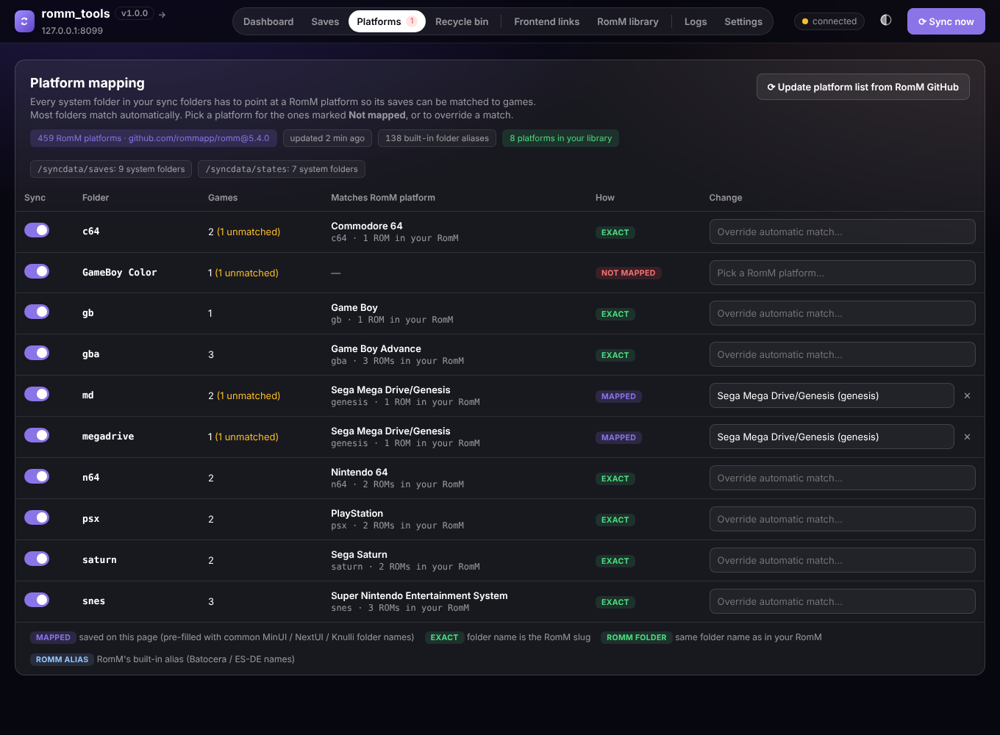

# Save sync reference

The **save sync** part of [romm_tools](../README.md): emulator saves and save states between your
Syncthing folder and [RomM](https://romm.app/), both ways, with a web dashboard. It started as
**[romm_syncthing_sync](https://github.com/amn-96/romm_syncthing_sync)** by
**[amn-96](https://github.com/amn-96)** (MIT); the web GUI, two-way sync, approvals and conflict
handling were added in [sireteanu/romm_syncthing_sync](https://github.com/sireteanu/romm_syncthing_sync)
and moved here unchanged. See [NOTICE.md](../NOTICE.md) for who wrote what.

Install, the settings that are shared with the ROM folders part and how the two parts fit together
are in the [README](../README.md). This page is the full reference for save sync.

<picture>
  <source media="(prefers-color-scheme: light)" srcset="screenshots/dashboard-light.png">
  
</picture>

## Features

- **Web dashboard** on port `8080` (the same page as the ROM folders part):
  - live sync progress
  - every system with a status bar
  - every game with its RomM cover art and the latest save-state screenshot (from RomM, or RetroArch's local `.png`)
  - an activity log
- **RomM → folder sync.** Saves and states that are new or newer on RomM (from another device, the web player, Grout…) can be written back into your Syncthing folder. Syncthing then delivers them to your handhelds.
- **Asks only when it's unclear.** Everything syncs automatically in both directions. You're only asked when a file changed on both sides, was deleted on one side but changed on the other, or two different copies exist with no history. Each question explains why, and failures are listed with a plain-language reason.
- **Conflict handling.** If a file changed on *both* sides since the last sync, nothing is overwritten. The dashboard shows the two versions side by side (time, size, hash, screenshot) and you choose:
  - **keep the folder version**
  - **keep the RomM version**
  - **keep both** (your local copy is stored on RomM as a separate `(conflict …)` entry)
- **Backups.** Before any file is overwritten (on either side), the version being replaced is copied to `/data/backups/<date>/<system>/`.
- **Saves page.** Every save and state in your sync folders and on RomM in one list, with filters (system, type, folder only / RomM only / different / old versions). Tick files or whole games and delete them everywhere, download or upload them, or clear out the old copies RomM keeps of every upload.
- **Deletions sync, with a recycle bin.** Delete a save on either side and it's removed from the other too. The removed copy goes to a recycle bin you can restore from; it's cleared after a number of days you choose.
- **Platforms page** to map your system folders to RomM platforms. It uses RomM's official platform list and folder aliases, fetched from RomM's GitHub.
- **Logs page.** The full app log, filterable by level and searchable, with live updates and download, plus a list of recent uploads, downloads and decisions. The log is also kept in `/data/logs/romm_tools.log` (rotated). It holds the ROM folders part's messages too.
- **Settings page.** Change sync behaviour, intervals, backup retention and the dashboard password from the browser. Changes apply immediately, no restart.
- **Notifications** via Discord, ntfy, Gotify, Pushbullet or any webhook. You choose what to hear about: decisions needed, failed files, sync problems, sync activity. You get one message per sync and never the same item twice.
- **Looks like RomM.** The dashboard uses RomM 5.x's own colours, type and shapes, so it feels at home next to it. It isn't affiliated with the RomM project.
- **Unraid template** with the web UI link, icon and all settings (shared with ROM folders).

| Conflict resolution | Settings & notifications | Logs |
|---|---|---|
|  |  |  |

<details><summary>Phone layout</summary>


</details>

*(Screenshots use invented demo games and generated artwork from the bundled mock RomM server.)*

# Overview

*From the original author, amn-96:*

I've found that Romm is a nice way to have a "source of truth" for my game library, but for now, full-featured clients like [Grout](https://github.com/rommapp/grout) are not supported for all handhelds and Romm's planned sync feature is not ready (yet). If you have multiple handhelds whose saves are kept in sync with syncthing and want a way to have those in RomM so you can switch back and forth at will, **romm_sync** might help!

This all started when I set up Syncthing between my devices with Retroarch-based OS's (Android, MuOS, Knulli,...) and Minarch-based OS's (MinUI, NextUI) and none of the folders lined up properly and forced me into making a tedious Syncthing folder setup. Doable yes, but annoying. I had my Romm instance sitting right there and an opportunity to practice my Python for work so now...here we are.

## What you'll need
- A server or NAS (e.g. Unraid) that hosts a central file sync location. Syncthing works well, but technically it could be anything.
- A self hosted instance of RomM that is accessible from the machine this app runs on. RomM 4.5+ works; **5.x is recommended** (content hashes make change detection more precise).
- Docker to deploy the app.

## How it works
1. Gaming devices sync save files to a central location via Syncthing.
2. romm_tools detects new/modified saves and states in this "local library".
3. It matches the contents of your library with the content on your RomM instance.
4. For each save/state it compares both sides against what they looked like at the last sync, and then either syncs it, asks you, or flags a conflict.

```
Gaming Devices (RetroArch, etc.)
         ↕ (Syncthing)
    Central Sync Folder  ←──────────────┐
         ↕ (romm_tools watches + polls) │ approvals / conflicts
    RomM (via API)                      │
         ↕                              │
    Web dashboard :8080 ────────────────┘
```

### What gets synced automatically and what asks first

| Situation | What happens | Setting |
|---|---|---|
| A file changed **only locally** since the last sync | Uploaded automatically | — |
| A **new** local file RomM has never seen | Uploaded automatically | `PUSH_NEW_MODE=auto\|confirm` |
| A file is **new or changed on RomM** only | Downloaded automatically | `PULL_MODE=auto\|confirm\|off` |
| A file changed **on both sides** | **Asks**: conflict | `FORCE_PUSH_SYNC=true` makes local always win |
| A synced file is **deleted on one side** and unchanged on the other | The other side's copy is removed too and kept in the **Recycle bin** | `DELETE_MODE=auto\|ask\|off` |
| A deleted file was **changed on the other side** since the last sync | **Asks** (the change might matter) | — |
| Both copies exist and **differ, with no sync history** yet, and RomM's is newer | **Asks** (unclear which has your progress) | — |

Every question shows *why* it's being asked. Files that fail to sync appear under **Errors** with a plain explanation (for example "the API token lacks permission to write saves", "the sync folder is read-only", "RomM rejected the file as too large"), plus **Retry**/**Dismiss** buttons. They clear themselves once they sync.

If you skip an item, you won't be asked about it again until one of the two copies changes.

**Upgrading from the original romm_sync:** the first time this version sees a file on both sides, there is no sync history to compare against yet. It falls back to the original rule: if the local copy is newer it gets uploaded, otherwise it is assumed to be in sync. On RomM 5.x, saves carry a content hash, so a save that really differs and is newer on RomM is offered for download instead. No false conflicts are raised on the first run.

## Some caveats

### Limited scope of save support
*(original author)* I wrote this mainly for my uses, so it's probably not taking everybody possible folder structure into account. My Retroarch instance is configured similar to the Knulli defaults, so it should cover common usage patterns.

- Sort Saves by Content Directory
- Sort States by Content Directory

### Possible incompatibilities
It *does not* sort states by core, though I had some leftover different cores for Nintendo DS that seemed to work ok. This will work best with save (.srm) files, and, if you're consistent in the cores you use, .state files should "just work" as well.

The implicit assumption here is that the game files (ROM, with one M) on your device are *already* the same files as the ROMs in your RomM library. Set up your RomM library before trying to run this app. RomM allows you to map your *local* directory names to *their supported platform names* ("slugs") to make library management easier. [See the docs here.](https://docs.romm.app/latest/Getting-Started/Configuration-File/?h=platform+name#custom-folder-names)

### Downloads land next to the files your devices already use
Files pulled from RomM are written into the same `<sync folder>/<system folder>/` layout, named the way RetroArch expects (`Game (USA).srm`, `Game (USA).state1` + `.state1.png`). RomM-only games are placed in an existing system folder that maps to the game's RomM platform. If you have no folder for that system yet, create it and check it on the Platforms page.

### Still not a full RomM client
This doesn't download ROMs or manage your library. For devices that can run a real RomM client (e.g. Grout), that's still the better choice. This tool is for the devices that can't.

# Install

See [Install](../README.md#install) in the README: one container for both parts. Save sync needs
the RomM settings and the saves/states folders below; everything else has a default.

## Configure

All settings are environment variables (`.env.example`, or the Unraid template). Save sync runs when
`SAVE_SYNC` is `true`, or `auto` (the default) and a RomM address or sync folder is set; when a
required setting is missing, the error is in the log and on the ROM folders page, and the ROM
folders part keeps running.

### RomM

**`ROMM_URL`** (required): your RomM instance's address.

**`ROMM_AUTH_TYPE`** (required): `api` (recommended) or `http`. "api" lets publicly hosted RomM instances stay locked behind OIDC.

**`ROMM_API_TOKEN`** (required for api auth): in RomM, click your profile image → **Client API Tokens** → Create. The token needs read access to ROMs and platforms and **read + write for saves/states (assets)**. The original author's limited set below works. It can't write to the ROM library, collections or users:


**`ROMM_USERNAME` / `ROMM_PASSWORD`** (required for http auth).

**`ROMM_API_LIMIT`** (optional): page size when reading the RomM library. Default 500 (RomM allows up to 10,000). Only platforms that have a folder in your sync folders are read, and RomM is asked to skip the gallery extras it normally computes for every page, so even large libraries read quickly.

### Sync folders

#### Single sync folder
All saves and states sorted by content directory in one parent folder (Knulli-style):
```
{SYNC_FOLDER}/
├── Nintendo 64/
│   ├── Game Name.srm
│   ├── Game Name.state
│   └── Game Name.state.png
└── Game Boy Advance/
    ├── Another Game.srm
    └── Another Game.state
```
Use only **`ALL_SYNC_FOLDER`**.

#### Separate save and state parents
*(original author)* This is the way I do it because CFWs like MuOS and MinUI/NextUI put their saves and states in completely different places, but still sort by content directory.
```
{SAVE_SYNC_FOLDER}/            {STATE_SYNC_FOLDER}/
├── Nintendo 64/               ├── Nintendo 64/
│   └── Game Name.srm          │   ├── Game Name.state
└── Game Boy Advance/          │   └── Game Name.state.png
    └── Another Game.srm       └── Game Boy Advance/
                                   └── Another Game.state
```
Use **`SAVE_SYNC_FOLDER`** and **`STATE_SYNC_FOLDER`**.

### Sync mode

**`SYNC_MODE`**:
- `watch` (default, recommended): full sync on start, then incremental syncs on file changes. RomM is also checked every `ROMM_POLL_INTERVAL_SECONDS`, because changes made on RomM don't create local file events.
- `periodic`: full sync every `SYNC_INTERVAL_SECONDS`.

**Lets your disks sleep (watch mode).** The app only ever reads the folders you map into it: your saves and states folders, and `/data`. It never reads your ROMs, because the game list comes from RomM's API. The RomM check is quiet: it asks RomM for its list of saves and states (no disk access). When something changed on RomM, only the games it changed for are synced, reading just their files. A save you changed is synced on its own, without re-reading the rest of the folder. The folders are read in full only at startup, on **Sync now**, and once every `FULL_SCAN_INTERVAL_HOURS` as a safety net (`0` = never). The dashboard shows when that last happened (*Last folder scan*).

On Unraid, the best setup is to keep the saves/states share and `appdata` on a cache pool (*Primary storage: Cache*, *Secondary storage: None*). Then nothing this app or Syncthing does can spin up array disks.

A full sync now fetches all saves and states in two API calls instead of two per game, so it's quick even for large libraries.

| Variable | Default | |
|---|---|---|
| `WATCHDOG_DELAY_SECONDS` | 60 | watch: quiet time after file activity before syncing |
| `ROMM_POLL_INTERVAL_SECONDS` | 600 | watch: how often to check RomM for changes. `0` = only when you click **Sync now** |
| `FULL_SCAN_INTERVAL_HOURS` | 24 | watch: re-read the sync folders anyway this often, in case a file change was missed. `0` = only at startup and on **Sync now** |
| `SYNC_INTERVAL_SECONDS` | 1800 | periodic: seconds between full syncs (each one reads the sync folders) |
| `FULL_INITIAL_SYNC` | true | `true`, `false`, or `force` (force-push once on startup) |
| `FORCE_PUSH_SYNC` | false | local always wins, even over conflicts. Dangerous |
| `DRY_RUN` | false | test mode: nothing is uploaded, downloaded or deleted; syncs only log what they would do. Also a switch on the Settings page |

### Two-way sync & approvals

| Variable | Default | |
|---|---|---|
| `PUSH_NEW_MODE` | auto | new local files → RomM: `auto` or `confirm` (ask for every new file) |
| `PULL_MODE` | auto | RomM → folder: `auto`, `confirm` or `off` |
| `BACKUP_RETENTION_DAYS` | 30 | keep backups of overwritten files this long (`0` = forever) |
| `DELETE_MODE` | auto | a synced file deleted on one side: `auto` (remove the other copy too, into the recycle bin), `ask`, or `off` (never delete; asks to re-download/re-upload) |
| `RECYCLE_RETENTION_DAYS` | 30 | clear recycle bin items after this many days (`0` = never) |
| `ROMM_KEEP_VERSIONS` | 0 | RomM keeps a copy per upload; keep only this many per file and move older ones to the recycle bin after each sync (`0` = keep all). The copy your folder is synced with is always kept |
| `DATA_FOLDER` → `/data` | `./data` | sync history, pending approvals, backups. **Keep this persistent**, it's how changes on each side are told apart |
| `PUID` / `PGID` | — | owner of files written into the sync folders (Unraid: `99` / `100`) |
| `FILE_MODE` | 0777 | permissions for files and folders written into the sync folders and backups (also on the Settings page) |

### Saves page



The **Saves** page lists every save and state, in your sync folders and on RomM, grouped by game. For each one it shows the size and age of the copy in your folder and on RomM, how many versions RomM holds, and whether the two copies match.

Filter by system, saves or states, or by where a file is (*In both*, *Folder only*, *RomM only*, *Different*, *Old versions*). Tick single files, whole games, or everything shown, then:
- **Delete**: removes the files from your sync folder **and** RomM (every RomM version). Copies go to the recycle bin first. If the RomM copy differs from yours, both copies are kept in the bin.
- **Remove old RomM versions**: RomM 5.x keeps a copy every time a file is uploaded. This keeps the newest and moves the older ones to the recycle bin. Your folder isn't changed.
- **Download to folder** (files only on RomM) and **Upload to RomM** (files only in your folder that are matched to a RomM game).

- **Download .zip**: the selected files laid out like your sync folders (`saves/<system>/…`, `states/<system>/…`), from your folder or RomM's newest copy. A quick off-server backup.

Bulk actions run in the background with a progress bar; anything that fails is listed with the reason. The page reads your sync folders only when you open or reload it.

**Version history.** Click a file name to see every copy the app knows about: the one in your folder, each version RomM keeps, the backups made before overwrites, and recycle bin entries. **Download** any of them, or **Put back** one into your sync folder (the current copy is backed up first). The next sync uploads it to RomM. Handy when a save got corrupted or you want to go back to before a bad decision.


### Recycle bin



When you delete a synced save or state on one side, the copy on the other side is deleted as well. It isn't destroyed: it's moved to the **Recycle bin** (`/data/recycle`) first.
- Delete a save in your sync folder → it's downloaded from RomM into the bin, then removed from RomM (all of RomM's versions of it).
- Delete a save in RomM → the local file (and its screenshot) is moved into the bin.

On the Recycle bin page you can **Restore** an item (it goes back into your sync folder and the next sync uploads it to RomM again), **Download** it, **Delete** it forever, or **Empty recycle bin**. Items are cleared automatically after `RECYCLE_RETENTION_DAYS` (Settings → *Clear the recycle bin after*; `0` = never).

Safety rails:
- Only deletes a file that is **unchanged** on the other side since the last sync. If it was changed there, you're asked instead.
- If more than **10** files would be deleted in one sync (a folder unmounted, a share offline…), nothing is deleted. They're listed under **Needs attention → Deletions** with *Delete all* / *Bring all back*.
- Set `DELETE_MODE=ask` to confirm every delete, or `off` to never carry deletions over.

### Web UI

| Variable | Default | |
|---|---|---|
| `WEB_UI` | true | turn the web page off with `false` (both parts keep running) |
| `WEB_HOST_PORT` | 8080 | host port (compose) |
| `WEB_USERNAME` / `WEB_PASSWORD` | empty | optional basic auth for the dashboard |

The password covers the whole web page, the ROM folders pages too. There is no other login. Don't expose it to the internet without a password or a reverse proxy with auth.

### Platform mapping

Each system folder in your sync folders (`snes`, `md`, `Nintendo 64`, …) has to point at a RomM platform so its saves can be matched to games. Open the **Platforms** tab in the dashboard to see how every folder resolves and fix the ones that don't:



Use the **Sync** switch on a row to stop syncing a system (for example arcade) without removing its folder. Its files are left alone in both directions until you switch it back on.

Folders are resolved in this order, and most never need a mapping:

1. **Mapped**: chosen on the Platforms page (pre-filled with common folder names)
2. **Exact**: the folder name is a RomM platform slug (`snes`, `gba`, `n64`…)
3. **RomM folder**: the folder has the same name as that platform's folder in *your* RomM library
4. **RomM alias**: one of RomM's built-in folder aliases for Batocera / RetroBat / ES-DE names (`megadrive`, `amstradcpc`, `atarilynx`…)

**Where the platform list comes from:** the full list of platforms RomM supports (459 at the time of writing) and RomM's folder aliases are downloaded from GitHub. Slugs and aliases come from [`rommapp/romm`](https://github.com/rommapp/romm), fetched at the tag that matches your RomM server's version when that tag exists, with display names from [`rommapp/docs`](https://github.com/rommapp/docs). The list is cached in `/data/romm_platforms.json` and refreshed weekly, or whenever you click **Update platform list from RomM GitHub**. If GitHub can't be reached, the cached list is used. In the picker, platforms that are already in your RomM library are listed first.

**Starting point:** on first start the mapping is pre-filled with the common MinUI/NextUI and Knulli folder names from the original project (for example `md` and `megadrive` → Sega Mega Drive/Genesis, `sfc` → SNES). After that you manage it only on the Platforms page. Remove an entry with ✕ to fall back to automatic matching. It's stored in `/data`, so it survives updates.

See https://docs.romm.app/latest/Platforms-and-Players/Supported-Platforms/ for RomM's supported platforms.

### Settings page & notifications

Most behaviour can be changed on the dashboard's **Settings** tab instead of in the container config. Values saved there override the container's and apply immediately. Each one shows whether it comes from the container or was changed in the dashboard, with a **reset** link. Settings are stored in `/data/settings.json`. Saved tokens and passwords are never sent back to the browser.

**Notifications.** Add one or more services under Settings → Notifications:

| Service | What you need |
|---|---|
| Discord | A channel webhook URL (Channel → Edit → Integrations → Webhooks) |
| ntfy | Server (default `https://ntfy.sh`), topic, optional access token |
| Gotify | Server URL and an application token |
| Pushbullet | Your access token (Pushbullet → Settings → Access Tokens) |
| Webhook | Any URL; receives `{"title", "message", "priority", "url"}` as JSON |

Pick what to be told about:
- **Questions:** a conflict or other file needs your decision.
- **Errors:** a file failed.
- **Sync problems:** RomM unreachable, token rejected, and when it recovers.
- **Sync activity:** off by default.

If you set the **Dashboard address**, messages link straight to it. Use **Send test** to check a service.

### Syncthing integration (optional)

Under Settings → Syncthing, enter your Syncthing address (e.g. `http://192.168.1.6:8384`) and API key (Syncthing → Actions → Settings → General), save, then tick the Syncthing folders that hold your saves and states. Then:
- the app waits until Syncthing has finished receiving files in those folders before it syncs a change (at most 10 minutes), so a half-received save is never uploaded. You can lower *Wait after a file changes* to a few seconds;
- the dashboard shows the devices sharing those folders, whether they're connected and how up to date they are.

Only Syncthing's read-only REST API is used; nothing in Syncthing is changed. Also settable with `SYNCTHING_URL`, `SYNCTHING_API_KEY` and `SYNCTHING_FOLDERS` (comma-separated folder IDs).

### Health check

The image has a Docker health check (`/api/health`). The container is shown as **unhealthy** in Unraid/Docker when syncs have been failing for 15 minutes, for example because RomM is unreachable or the token was revoked. It turns healthy again after the next successful sync. With save sync off, the health check only says whether the web page answers.

# Developing

Tests, the mock RomM server, releases and the code map are in the [README](../README.md#development-tests-and-releases).
See [TWO_WAY_SYNC.md](TWO_WAY_SYNC.md) for how the sync engine decides what to do, and
[IMPLEMENTATION_SUMMARY.md](IMPLEMENTATION_SUMMARY.md) for the original architecture write-up by amn-96.

### How saves are matched to games

- **Files from RomM's own player and other devices** are renamed to what RetroArch expects when they're downloaded. RomM 5.x stores them under other names: `autosave [2026-08-17_19-02-17].srm`, `Game [date].autosave.state0`. These become `Game (USA).srm` and `Game (USA).state` (slot 0 is `.state` in RetroArch), matching the ROM's file name (or your save's own name, if it was matched by title or linked by hand). RetroArch keeps one save file per game, so when several RomM versions map to the same name, the newest one is synced. That's how progress from the web player or another device reaches your handhelds. The older versions are still on RomM: see them under **Version history** on the Saves page, put one back, or have old ones cleared automatically with `ROMM_KEEP_VERSIONS`.

- **One game per system folder.** A save belongs to the game in the same system folder: `gb/Tetris (World).srm` and `gbc/Tetris (World).srm` are two different games, each matched to its own RomM ROM. A save and a state of the same game in separate saves/states folders (`saves/gba/…`, `states/gba/…`) are still one game.
- **Exact name first.** A save named after the ROM file (`Pokemon Red (USA, Europe).srm` ↔ `Pokemon Red (USA, Europe).gb`) is matched exactly. A shorter name only matches a ROM whose file name *starts* with it, and the closest one wins. Text in the middle of a name never matches, so "Mario" can't pick "Super Mario World".
- **Same title, different spelling.** If neither of those matches, a save matches a ROM with the same title once punctuation, region/version tags and trailing articles are ignored: `zelda_spirit_tracks.sav`, `The Legend of Zelda: Spirit Tracks.sav` and `Legend of Zelda, The - Spirit Tracks (USA) (En,Fr,Es).nds` all count as the same title, and RomM's own game name counts too. If several ROMs share that title, the one with the same region tags wins; if that's still a tie, nothing is guessed.
- **Link by hand.** For anything else (a renamed save, a hack, a save from another emulator), open the **Saves** page, filter by *Not matched* and click **Link to a RomM game…**. Pick the game; its saves and states then sync with it, and files from RomM are written under your save's name so your emulator finds them. Links are stored in `/data/game_links.json` and can be changed or removed the same way. A ROM can only be linked to one local game.

  
- **Dots in names** ("Dr. Mario (USA).srm", "Super Mario Bros. 3") are handled everywhere, including watch mode.
- **Two folders, one platform.** If two of your folders point at the same RomM platform (e.g. `md` and `megadrive`) and both contain the same game, the first is synced and the other is listed under **Errors** with an explanation, instead of the two copies overwriting each other on RomM.

# Known issues

- ~~Saves must be named after the ROM file.~~ Saves with the same title in another spelling match automatically, and anything else can be linked by hand on the Saves page (2.11.0).
- ~~RomM 5.x versions: the newest wins and older ones are hidden.~~ RetroArch uses one save per game, so the newest version is still the one synced, but every older version can be seen, downloaded and put back from Version history, and cleaned up with `ROMM_KEEP_VERSIONS` (2.10.0).
- ~~Retroarch's state screenshots are not linked to the corresponding state file on the RomM server.~~ Fixed in RomM.
- ~~Only HTTP Basic Authentication.~~ API tokens supported since 1.4.0.
- ~~Syncthing only PUSHES to RomM.~~ RomM → folder sync added in 2.0.0.

# Credits & license

- Original project: **[romm_syncthing_sync](https://github.com/amn-96/romm_syncthing_sync) by [amn-96](https://github.com/amn-96)**. Thank you!
- Web GUI, two-way sync and everything listed under *Features*: [sireteanu](https://github.com/sireteanu), first in the fork [sireteanu/romm_syncthing_sync](https://github.com/sireteanu/romm_syncthing_sync).
- [RomM](https://github.com/rommapp/romm) by the RomM team. This project only uses its public API.

MIT License. See [LICENSE](../LICENSE) (original copyright retained) and [NOTICE.md](../NOTICE.md).
